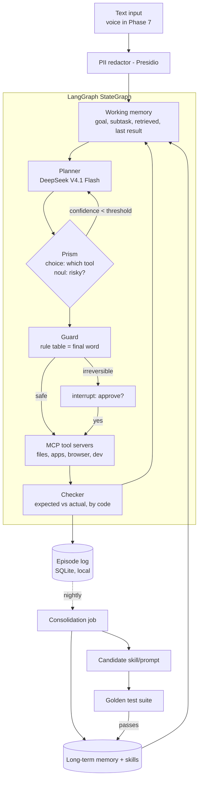
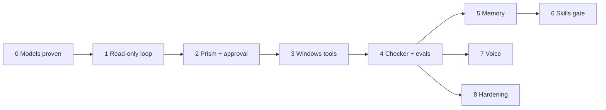

# Brain Agent: Vibe-Coding Build Plan

A Windows 11 desktop agent in Python. LangGraph runs the loop, Sarvam Prism makes the decisions, DeepSeek V4.1 Flash does the reasoning, and Saaras/Bulbul add voice at the end.

This plan turns the research report into slices you can build one at a time. Each phase is small enough to finish in a few sessions and ends with a test you can run. There are no deadlines: don't start a phase until the previous one passes its **Done when** checks.

Claims marked **[verify]** weren't confirmed in official docs. Check them before you build on them.

---

## 0. What changed from the research report

| Role | Report assumed | You picked | Notes |
|---|---|---|---|
| Decision model | Jev (TypeSafe) | **`sarvam-prism`** | Sarvam's decision model, built on Sarvam-105B. It returns probabilities, never text. Endpoint `POST /v2/systemone`, Python `client.decisions.create(...)`, needs `sarvamai >= 0.1.43`. Costs ₹4 per 1M input tokens; output is free. Supports English, 10 Indian languages and Hinglish, with lower confidence in Indian languages. 32,768 tokens per question, 2–255 options. ([Sarvam docs](https://docs.sarvam.ai/api/token-factory/models/sarvam-prism)) |
| Reasoning LLM | Sarvam-105B | **`deepseekv4.1-flash-1017`** | Served by Sarvam with your Sarvam API key. See section 0.1 for details. ([Sarvam model page](https://docs.sarvam.ai/api/token-factory/models/deepseek-v4.1-flash-1017)) |
| STT | — | **`saaras:v4`** | 23 languages, with transcribe, translate, verbatim, translit and codemix modes. REST requests are limited to 30 s; WebSocket streaming is available. ([Saaras docs](https://docs.sarvam.ai/api/getting-started/models/saaras/llms.txt)) |
| TTS | — | **`bulbul:v4-flash`** | Sarvam's latest TTS model. Read its Best Practice Guide before Phase 7. ([Sarvam blog](https://www.sarvam.ai/blogs/bulbul-v4-flash/)) |

**What this changes:**
- **One vendor, one API key.** All four models run through Sarvam, so privacy rules apply to a single provider.
- **Prism replaces Jev** in every place the report used Jev. The report's ≥0.7 confidence threshold still applies, but tune it on your own data (Phase 4).
- **How DeepSeek connects to LangChain.** Sarvam's LangChain page lists only `sarvam-105b` for `ChatSarvam`, and its default base URL is `/v1`, while DeepSeek is served on `/v2`. Plan on the official `sarvamai` SDK call shown below, wrapped in a small custom LangChain chat model (Phase 0). Trying `ChatSarvam(model="deepseekv4.1-flash-1017")` is a quick test, but it's unsupported **[verify]**.

### 0.1 DeepSeek V4.1 Flash 1017 on Sarvam — confirmed details

Source: [Sarvam model page](https://docs.sarvam.ai/api/token-factory/models/deepseek-v4.1-flash-1017).

**Model IDs**
- `deepseekv4.1-flash-1017`: about 80 output tokens/s.
- `deepseekv4.1-flash-1017-interactive`: over 200 tokens/s and about 2x the price. Use it for voice in Phase 7.

**Endpoints and auth**
- `POST /v2/chat/completions` and `POST /v2/responses`.
- Header: `api-subscription-key` (your Sarvam key).

**SDK call**
```python
from sarvamai import SarvamAI

client = SarvamAI(api_subscription_key=KEY)
r = client.chat.completions_v2(
    model="deepseekv4.1-flash-1017",
    messages=[...],
    max_tokens=4000,
    reasoning_effort="low",
)
```

**Context:** 1,048,576 tokens, shared by the prompt, reasoning and output.

**Tools**
- OpenAI-style `tools` and `tool_choice`, including `"required"`.
- `parallel_tool_calls` is listed as `false`, so plan for one tool call per turn **[verify on API reference]**.

**Reasoning**
- `reasoning_effort`: `none`, `low`, `high` (the default) or `max`. Must be a string.
- Reasoning text is returned in `reasoning_content`.
- **Trap:** reasoning counts toward `max_tokens`. If it runs out, you get HTTP 200 with `content: null` and `finish_reason: "length"`.
  - Always set `max_tokens` explicitly.
  - Use `low` for routine steps and `high` only when re-planning.
  - Treat `content: null` as a retryable error.

**Images:** base64 data URIs only; image URLs return 400. Useful later for screenshots.

**Pricing (per 1M tokens):** ₹14 input, ₹0.25 cached input, ₹55 output. Reasoning is billed as output.

**Errors:** 403 bad key, 404 unknown model, 402 out of credits, 429 rate limited, 503 overloaded. Retry 429/503 with backoff.

**Not documented:** whether DeepSeek inputs are kept or used for training. Ask Sarvam support; until then, redact before every call (Phase 8 rule, moved into Phase 1).

---

## 1. Architecture



**Brain mapping.** Each part of the agent gets a brain label only because the research found real evidence behind it:

| Brain function | Component | Phase |
|---|---|---|
| Prefrontal (goals, planning) | Planner node + goal kept in state | 1 |
| Basal ganglia (action selection) | Prism `choice` router | 2 |
| Anterior cingulate (conflict check) | Guard + Prism `noul` risk check | 2 |
| Cerebellum (predict, compare) | Expected-result field + code checker | 4 |
| Hippocampus (fast episodes) | Episode log + vector index | 5 |
| Sleep consolidation | Nightly summarise/score/decay job | 5 |
| Soar chunking (learn skills) | Solved procedures become saved skills, gated by tests | 6 |

---

## 2. Repo layout (create in Phase 0)

```
brain-agent/
├─ pyproject.toml          # uv-managed
├─ .env.example            # SARVAM_API_KEY=...
├─ config/
│  ├─ agent.yaml           # model IDs, thresholds, enabled tools
│  └─ permissions.yaml     # tool -> tier (read / reversible / irreversible)
├─ brain/
│  ├─ models.py            # LLM + Prism wrappers (swappable)
│  ├─ graph.py             # LangGraph StateGraph
│  ├─ state.py             # typed AgentState
│  ├─ guard.py             # permission tiers, rule table
│  ├─ checker.py           # expected-vs-actual verifiers
│  ├─ memory/              # episode log, store, consolidation
│  └─ privacy.py           # Presidio redaction
├─ tools/                  # one MCP server per capability
│  ├─ files_server.py
│  ├─ system_server.py
│  ├─ browser_server.py
│  └─ dev_server.py
├─ voice/                  # Phase 7
├─ evals/
│  ├─ golden/*.yaml        # tasks + programmatic checks
│  └─ run_evals.py
├─ sandbox/                # throwaway folders the agent may touch
└─ cli.py                  # text chat entry point
```

**Rule for the coding agent:** model IDs, thresholds and permission tiers live in `config/`, never hard-coded. Swapping a model should be a one-line YAML change.

---

## 3. Phases

Each phase lists its goal, what to build, a prompt to paste into your coding agent, and **Done when** checks.

### Phase 0 — Prove the four models work (setup)

**Goal:** confirm every model ID, auth method and quirk before writing any agent code.

**Build:**
- Create a project with `uv init`, then add `langgraph`, `langchain-sarvam`, `langchain-openai`, `sarvamai>=0.1.43`, `python-dotenv` and `pyyaml`.
- Write `scripts/smoke_*.py`, one script per model:
  1. **DeepSeek V4.1 Flash (`deepseekv4.1-flash-1017`):**
     - Send a plain chat message with `client.chat.completions_v2`.
     - Make one tool call with a dummy `get_time` tool.
     - Force `max_tokens=50` with `reasoning_effort="high"` to reproduce `content: null` / `finish_reason: "length"`, and confirm your code retries it.
     - Build `brain/models.py: SarvamChatModel`, a custom LangChain `BaseChatModel` that wraps `completions_v2` and supports `bind_tools`. Then check that a LangGraph `ToolNode` works with it.
  2. **Prism:** send one `choice`, one `noul` and one `score` question. Ask the same `choice` in English, Hindi and Hinglish and compare the confidence values.
  3. **Saaras v4:** transcribe a 10-second WAV.
  4. **Bulbul v4 Flash:** speak one sentence to a file.
- Opt out of Sarvam API training in the dashboard. Its privacy policy says training is on unless you opt out.

**Prompt:**
> Create a uv Python project `brain-agent` with the repo layout in PLAN.md section 2. Add smoke-test scripts in `scripts/` for: (a) model `deepseekv4.1-flash-1017` via `SarvamAI().chat.completions_v2` (sarvamai SDK), including one tool call and a forced `content: null` case (tiny max_tokens), plus a custom LangChain `BaseChatModel` wrapper `SarvamChatModel` supporting `bind_tools` and passing tool calls back as `AIMessage.tool_calls`; (b) sarvam-prism via `SarvamAI().decisions.create` with one choice, noul and score question each, run in English, Hindi and Hinglish; (c) saaras:v4 STT on `samples/test.wav`; (d) bulbul:v4-flash TTS to `out/test.wav`. Read model IDs from `config/agent.yaml` and the key from `.env`. Print latency and token usage for each. Fetch Sarvam docs for exact signatures before writing code; don't guess parameters.

**Done when:**
- All 4 scripts pass.
- `SarvamChatModel` completes one tool-calling round trip inside a tiny LangGraph graph.
- You've written down Prism's latency and its English vs Hindi confidence numbers.

### Phase 1 — Text loop with read-only tools

**Goal:** a CLI chat whose LangGraph loop can look at your PC but can't change anything.

**Build:**
- `AgentState` holding the goal, messages, plan, last result and step count.
- Nodes: `plan` (DeepSeek), `act`, `observe`.
- Read-only tools: `list_dir`, `read_file`, `search_files`, `list_processes`, `system_info`.
- `SqliteSaver` checkpointer so conversations persist between runs.
- A step limit of 15 to stop runaway loops.

**Prompt:**
> Implement `brain/graph.py` as a LangGraph StateGraph with plan → act → observe → plan, ending when the planner says done or after 15 steps. Use DeepSeek from `brain/models.py` with tool calling. Only register read-only tools: list_dir, read_file (max 200 KB), search_files, list_processes, system_info, restricted to folders listed in `config/agent.yaml: allowed_roots`. Add SqliteSaver persistence and a `cli.py` REPL. Print each step's tool and result summary.

**Done when:**
- "What's taking space in my Downloads?" gives a correct answer.
- Asking it to read a file outside `allowed_roots` is refused.

### Phase 2 — Prism decisions + safety tiers + approval

**Goal:** Prism chooses tools and flags risk, code enforces the tiers, and you approve anything irreversible.

**Build:**
- `brain/models.py: PrismDecider`, a thin wrapper that returns `{option, confidence, probs}`. Wrap it as a LangChain `RunnableLambda`; no official LangChain wrapper for Prism was found **[verify]**.
- A router node that sends the state and the list of available tools to Prism as a `choice` question.
  - If confidence is below the threshold (start at 0.7), go back to DeepSeek and let it choose.
- `config/permissions.yaml`, mapping every tool to `read`, `reversible` or `irreversible`.
- The guard node:
  - Applies the rule table, which always wins.
  - Asks Prism a `noul` question ("could this lose data or contact someone?") as a second check.
  - If either says risky, it calls `interrupt()` to pause for approval, then continues with `Command(resume=...)`.
- Make side effects idempotent. A node interrupted for approval restarts from its top when resumed, so anything it did before the interrupt runs again.

**Prompt:**
> Add a Prism-based router node and a guard node to the graph per PLAN.md Phase 2. The router asks sarvam-prism a `choice` over the enabled tool names, given the current goal and last observation. Below `config.thresholds.route_confidence` it defers to the DeepSeek planner's own tool choice. The guard reads `config/permissions.yaml`: read → run; reversible → log, then run; irreversible → LangGraph `interrupt()` showing the exact action, resumed via `Command(resume=bool)`. Also ask Prism a `noul` "is this action risky?" question; if p > 0.3, require approval even for reversible tools. The rule table can only make a decision stricter, never looser. Log every decision with its confidence to SQLite.

**Done when:**
- Read-only tasks run without asking you.
- A test "delete" action always pauses for approval.
- The log shows Prism's confidence for every routing decision.

### Phase 3 — Real tools for Windows (one MCP server each)

**Goal:** cover your four job areas. Each tool area is a separate MCP server you can swap out.

| Server | Tools (tier) | Windows libraries |
|---|---|---|
| `files` | move/rename/copy (reversible), delete → Recycle Bin only (reversible), organise-by-rule (reversible, always with a dry-run first) | `pathlib`, `send2trash` |
| `system` | open app, focus/close window, volume, read settings (read/reversible); change settings (irreversible) | `pywinauto` (UIA backend), `subprocess` + PowerShell, `pycaw` for audio |
| `browser` | open URL, search, read page text, summarise (read); submit form, log in, buy (irreversible) | Playwright with its own browser profile, not your main Chrome |
| `dev` | git status/diff (read), run script in `sandbox/`, start dev server, docker ps (reversible), git push, docker rm (irreversible) | `subprocess` with an allowlist of commands |

**Rules:**
- No raw shell tool. Every command goes through a named, allowlisted tool.
- Delete only means Recycle Bin.
- Bulk file changes print a dry-run diff first and run only after you confirm.

**Prompt (one server per session):**
> Build `tools/files_server.py` as an MCP server using the official Python MCP SDK. Tools: list, move, rename, copy, trash (send2trash only, never permanent delete), organise_by_rule with a required dry_run step that returns a planned-changes list. Every tool validates that paths are inside `allowed_roots`. Return structured results (`ok`, `changed_paths`, `error`). Register the server in `config/agent.yaml` and connect it to the graph with the LangChain MCP adapters. Add its tools to `permissions.yaml`.

**Done when:**
- Each server works on its own from a test script, then from the agent.
- "Clean up Downloads by file type" shows a dry run and only moves files after you approve.

### Phase 4 — Checker + golden test suite + tracing

**Goal:** turn "99% accuracy" into numbers you can measure.

**Build:**
- The planner writes `expected_result` before every tool call, for example `"file exists at X"`.
- `brain/checker.py` verifies it with code (file exists, exit code is 0, window title matches), never by asking the LLM. On a mismatch, log the step as important and re-plan.
- `evals/golden/`: 30–50 short tasks (≤5 steps), each with a setup step and a check that can be run as code. All tasks run inside `sandbox/`.
- `evals/run_evals.py`:
  - Runs each task 3 times.
  - Reports **pass^3** (did it succeed on all 3 runs), intervention rate, unsafe-action count, latency and ₹ cost.
  - Keeps a frozen subset aside that's never used for tuning.
- Self-hosted Langfuse in Docker for tracing. Redact PII before traces are sent.
- Tune the Prism threshold by plotting routing accuracy against confidence.

**Targets** (from the report):
- ≥99% pass^3 on the golden set.
- **0 irreversible actions without approval.**
- 99% of tasks either succeed or stop and ask you.

**Prompt:**
> Add an `expected_result` field to planned actions and a `checker.py` with code-based verifiers (path_exists, file_contains, exit_code_zero, window_title_matches, url_matches). Create `evals/golden/` with 30 YAML tasks across files, system, browser and dev, each with setup, instruction and check, all inside `sandbox/`. Write `run_evals.py` that runs each task 3 times with a fresh sandbox reset and reports pass^3, interventions, unsafe actions, latency and cost to a Markdown report plus JSON. Add a `--frozen` flag that runs only the held-out set.

**Done when:**
- You have a baseline report. Expect well under 99% at first; that's normal.
- Every later change is judged against this report.

### Phase 5 — Memory (hippocampus + sleep)

**Goal:** the agent remembers what worked and what you prefer, without polluting its memory.

**Build:**
- **Episode log** (append-only SQLite): goal, steps, results and outcome, with a source tag on each entry.
- **Long-term store:** LangGraph Store with embeddings, holding facts and preferences. Writes are queued for review, never written directly.
- **Retrieval:** before planning, fetch the top-k memories scored by recency, importance and relevance (the Generative Agents formula).
- **Nightly consolidation job** (Windows Task Scheduler):
  - Summarise the day's episodes.
  - Score importance and let stale items decay.
  - Propose new memories for you to approve.
- Text from web pages and files can't become memory unless you approve it. This blocks prompt injection through memory.

**Done when:**
- A preference you state once ("my projects live in D:\dev") is used in a later session.
- A malicious line inside a web page never reaches long-term memory.

### Phase 6 — Safe learning (skills)

**Goal:** the agent improves itself in ways you can audit.

**Build:**
- When a multi-step task succeeds, the consolidation job proposes saving it as a **skill**: a named, parameterised procedure in `skills/*.yaml`.
- A proposed skill, or a changed prompt, becomes active only if `run_evals.py` shows equal or better pass^3 **and** no new unsafe actions on the frozen set.
- Every promotion is a git commit, so rollback is `git revert`.

**Done when:** at least one skill has been promoted by passing the test gate, and you can roll it back.

### Phase 7 — Voice

**Goal:** push-to-talk in Hindi or English.

**Build:**
- A global hotkey records from the mic, sends audio to **Saaras v4** (codemix mode for Hinglish), runs the same graph, and speaks the reply with **Bulbul v4 Flash**.
- Use REST for clips under 30 s and move to WebSocket streaming later.
- Approval requests are spoken aloud, but the confirmation must be a key press, never a spoken "yes". Background audio or a video playing could say "yes".
- Load the Sarvam `speech-to-text` and `text-to-speech` skills when vibe-coding this phase. They cover the API pitfalls.

**Done when:** "Downloads saaf karo" plays a spoken dry-run summary and waits for your key press.

### Phase 8 — Hardening (ongoing)

- **Presidio redaction** of PII (names, phone numbers, emails, Aadhaar-like numbers) before every Sarvam call and every trace.
- **Untrusted content is data, not instructions.** Wrap anything read from screens, web pages or files in a clearly labelled block, and never let it change permissions.
- **Integrity check** of MCP tool schemas at startup (hash them in config).
- **Local fallback** (optional, after your RAM upgrade): run a local GGUF model for sensitive tasks. This is a separate track; see the research report's local-inference section.

---

## 4. Order of work



Phase 4 is the hinge. Everything after it is judged by the eval report, not by feel.

---

## 5. Vibe-coding rules for this repo

1. **One phase, one branch.** Merge only after the phase's **Done when** checks pass.
2. **Ask the coding agent to read docs before writing code.** Sarvam's APIs change fast; use the `chat`, `speech-to-text` and `text-to-speech` skills or Context7 rather than its memory.
3. **Never let the coding agent add a raw `shell(cmd)` tool.**
4. **Every new tool needs a tier in `permissions.yaml` and at least one golden test.**
5. **The agent only gets to touch `sandbox/` until Phase 4 is green.**

---

## 6. Open items to resolve

- [x] DeepSeek model string confirmed: `deepseekv4.1-flash-1017`, called through the `sarvamai` SDK.
- [ ] Whether `parallel_tool_calls` is really off for DeepSeek on Sarvam (check the API reference).
- [ ] DeepSeek data retention and training terms on Sarvam (ask support).
- [ ] Prism confidence on Hindi/Hinglish vs English, and the threshold you settle on (Phases 0 and 4).
- [ ] Prism and Token Factory data retention: the Prism docs page doesn't address privacy, so check Sarvam's policy and dashboard settings.
- [ ] Rate limits on your Sarvam plan (not published per minute in the docs found).
- [ ] Whether to run Windows Sandbox or a VM for browser and dev tasks, or rely on Recycle Bin, dry-runs and git for rollback.

---

## Sources

- [Sarvam Prism docs](https://docs.sarvam.ai/api/token-factory/models/sarvam-prism)
- [Sarvam Prism blog](https://www.sarvam.ai/blogs/sarvam-prism)
- [Sarvam docs index (Token Factory catalog)](https://docs.sarvam.ai/api/llms.txt)
- [Saaras docs](https://docs.sarvam.ai/api/getting-started/models/saaras/llms.txt)
- [Bulbul v4 Flash blog](https://www.sarvam.ai/blogs/bulbul-v4-flash/)
- [DeepSeek V4.1 Flash migration guide (SiliconFlow)](https://www.siliconflow.com/blog/deepseek-v4-1-flash-api-migration)
- [Sarvam DeepSeek V4.1 Flash 1017 model page](https://docs.sarvam.ai/api/token-factory/models/deepseek-v4.1-flash-1017)
- [Sarvam LangChain integration](https://docs.sarvam.ai/api/integration/langchain)
- Research report: *Brain inspired PC agent plan.md*
