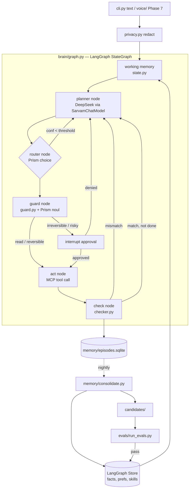
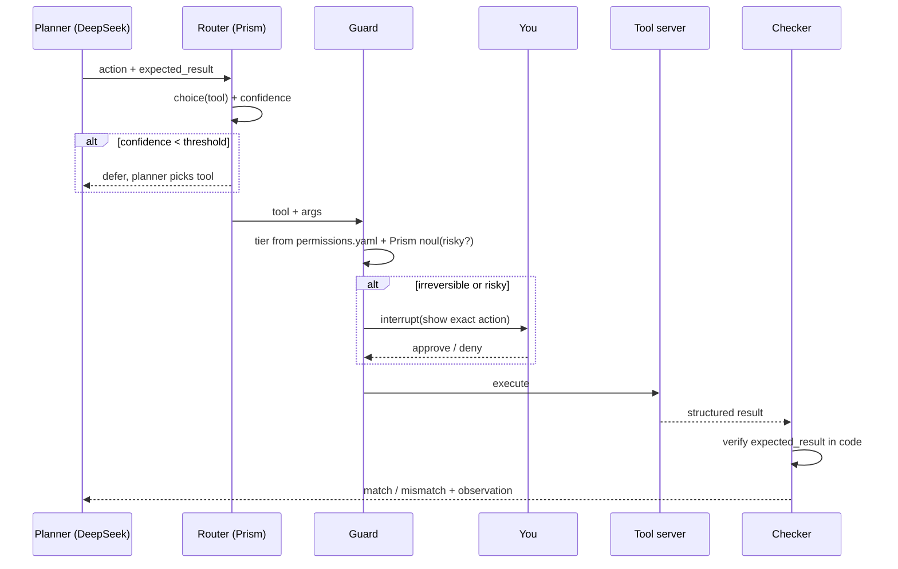

# Architecture

## One-line summary

A LangGraph state machine: the **planner** (DeepSeek) proposes an action and the result it expects, **Prism** picks the tool and scores the risk, the **guard** enforces permission tiers, a **tool server** acts, and the **checker** verifies the result with code. Each episode is logged, and a nightly job turns logs into memories and skills, which are kept only if they pass the eval suite.

## System diagram



## Per-step loop



## Modules and what they own

| Path | Owns | Must not |
|---|---|---|
| `cli.py` | REPL, prints steps, approval prompts | contain agent logic |
| `config/agent.yaml` | model IDs, thresholds, `allowed_roots`, enabled tool servers, step limit | — |
| `config/permissions.yaml` | tool → tier (`read`/`reversible`/`irreversible`), extra rules | be loosened by code at runtime |
| `brain/state.py` | `AgentState` (pydantic/TypedDict): goal, messages, plan, `expected_result`, last_result, step, mode | — |
| `brain/models.py` | `SarvamChatModel` (LangChain wrapper over `chat.completions_v2`), `PrismDecider`, retry/backoff | hold prompts or business rules |
| `brain/graph.py` | node wiring, edges, checkpointer (SqliteSaver) | call HTTP APIs directly |
| `brain/nodes/` | `planner.py`, `router.py`, `guard.py` node, `act.py`, `check.py` | — |
| `brain/guard.py` | tier lookup, rule table, risk merge (rules only make decisions stricter) | trust model output over rules |
| `brain/checker.py` | code verifiers: `path_exists`, `file_contains`, `exit_code_zero`, `window_title_matches`, `url_matches` | ask an LLM "did it work?" |
| `brain/privacy.py` | Presidio redaction for outbound text and traces | — |
| `brain/memory/` | `episodes.py` (append-only log), `store.py` (retrieval), `consolidate.py` (nightly job) | write to long-term memory without review |
| `tools/*_server.py` | one MCP server per capability: `files`, `system`, `browser`, `dev` | expose raw shell or permanent delete |
| `skills/*.yaml` | promoted procedures (Phase 6) | be edited without passing evals |
| `evals/` | golden tasks, runner, frozen set, reports | be tuned against the frozen set |
| `voice/` | Saaras STT, Bulbul TTS, hotkey (Phase 7) | approve actions by voice |
| `sandbox/` | the only folder the agent touches until Phase 4 | — |

## Data flow and privacy boundary

```
local only:  episodes.sqlite, Store, checkpoints, screenshots, Langfuse (self-hosted)
leaves PC:   redacted text → Sarvam (DeepSeek, Prism, Saaras, Bulbul)
```

Everything crossing that line passes through `privacy.py`.

## Swappability

- **LLM:** implement the `BaseChatModel` interface. Changing the model ID in `agent.yaml` is enough for any model Sarvam serves on `/v2/chat/completions`.
- **Decider:** `PrismDecider` returns `Decision(option, confidence, probs)`. Any replacement (local classifier, LLM structured output) must return the same type.
- **Tools:** add a new MCP server, register it in `agent.yaml`, add tiers and an eval task. No graph changes needed.

## Brain mapping (why each part exists)

| Brain function | Component | Evidence strength (research report) |
|---|---|---|
| Prefrontal goal keeping, planning | planner node, goal in state | moderate–strong |
| Basal ganglia action selection | Prism router | moderate |
| Anterior cingulate conflict monitoring | guard + Prism noul | moderate |
| Cerebellar forward model | `expected_result` + checker | moderate |
| Hippocampus (fast episodes) | episode log + index | strong |
| Sleep consolidation | nightly consolidate job | strong (CLS) |
| Soar chunking | skills promoted through evals | strong as a pattern |

If a brain-labelled component doesn't improve eval results, remove it.
